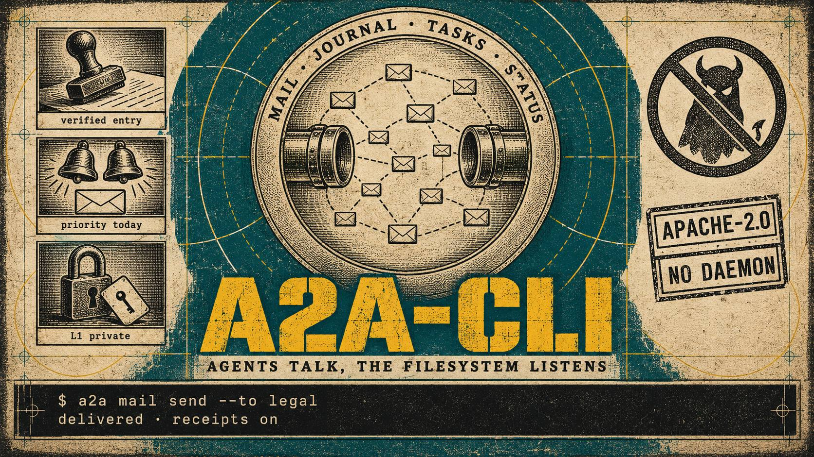

# a2a-cli

    


<p align="center"></p>

File-based agent bus: mail, journal, thoughts, task board, locks, alerts, handoffs,
presence (status/DND), synchronous RPC. Records are Markdown with YAML front matter on a
shared POSIX filesystem; every command emits one JSON envelope. No daemon, no broker, no
network.

[ Русский](README.ru.md) · **English**

## Install

> The PyPI project named `a2a-cli` is unrelated. Install from this repository only.

```bash
pip install git+https://github.com/lnfnt/a2a-cli.git
a2a --help
```

Dev checkout: `git clone https://github.com/lnfnt/a2a-cli.git && cd a2a-cli
&& python -m venv .venv && .venv/bin/pip install -e .`
Python >= 3.10, PyYAML.

## Quickstart: two profiles on one bus

```bash
export A2A_HOME=/tmp/a2a-demo
a2a onboard --profile alice
a2a onboard --profile bob

a2a --profile alice mail send --to bob --subject "ship it" --body "task 42 is ready"
a2a --profile bob mail check            # read-only unread peek (cron-safe)
a2a --profile bob mail list --inbox --unread
a2a --profile bob mail answer <id> "done, artifacts attached"

a2a --profile alice log "implemented bus schema" --artifacts ./SPEC.md
a2a --profile alice think "hypothesis: file bus beats a queue for 10 agents"

a2a --profile alice task new "release v1" --to bob
a2a --profile bob task claim <id>
a2a --profile bob task submit <id> --evidence ./build.log
a2a --profile alice task accept <id>

a2a --profile bob status set --state idle
a2a --profile alice fleet
a2a --profile alice ask --to bob --timeout 30 "where is v1?"

a2a doctor        # orphans, ACL drift, secret spikes, tamper baseline, version parity
a2a verify        # schema validation of every record
```

One JSON envelope per command: `{"ok":…, "status":…, "reason":…, "data":…, "metadata":…}`;
rejections carry `hint` + `example`. Exit codes: 0 ok, 1 error, 2 degraded, 3 invalid record,
4 usage, 124 timeout.

## Storage model

One directory tree, append-only records. Default store `~/.a2a`, override `A2A_HOME`.
Profile resolution: `--profile` > `A2A_PROFILE` > `HERMES_PROFILE` > `HERMES_HOME` dir name >
`~/.hermes/active_profile` > `default`. ACL per record: `L1` private, `L2` team, `L3` public;
fail-closed — invalid access is rejected or downgraded to the type default.

## Integrity

- Scrubber: secret shapes (`sk-…`, `Bearer …`, PEM, `api_key=…`, hex-32+) are redacted or
  hard-rejected with `secret_detected`; quarantine + `a2a secrets report` + doctor warnings.
- Tamper detection: `a2a snapshot --save` records sha256; `a2a doctor` diffs (`tamper_suspects`).
- Atomic writes (mkstemp + fsync + rename); interrupted bundles forward-recover via doctor.
- Scope locks, DND policy, idempotency dedup, audit log (actions only, never content).
- SQLite FTS5 search index — derived, rebuildable (`a2a index --rebuild`).

## Limits

- Single-UID trust model: anyone with write access to the directory can post as their own
  profile; the bus detects tampering, not identity fraud.
- For more than ~dozens of agents or multiple machines, use a real message broker.
- `ask` is bounded synchronous coordination (timeout + answer file), not chat.

## Docs & tests

`SPEC.md`, `SCHEMA.md`, `LIMITATIONS.md`, `NOTES.md`, `a2a cookbook`.
`python -m pytest -q` — 405 tests against temp `A2A_HOME` dirs.
Apache-2.0 (`LICENSE`). Verify artifacts: `sha256sum -c SHA256SUMS`, `gpg --verify *.asc`.

Author and copyright holder: [lnfnt](mailto:lnfnt@proton.me).
